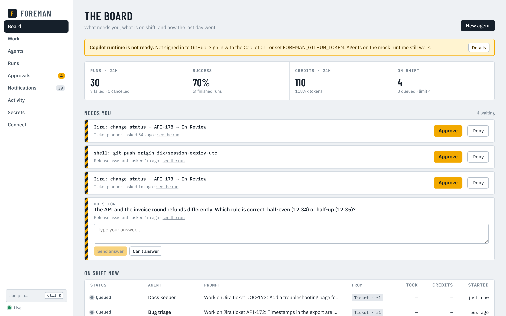
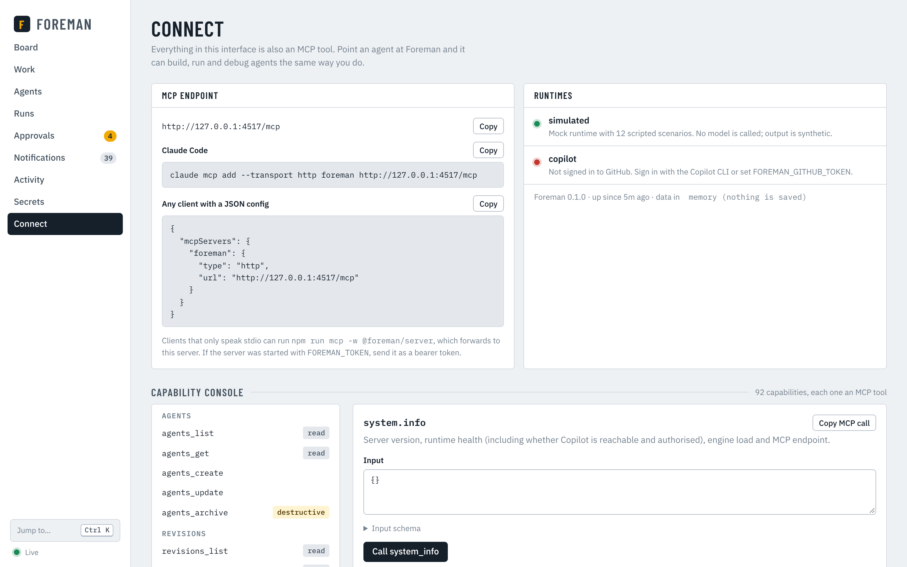
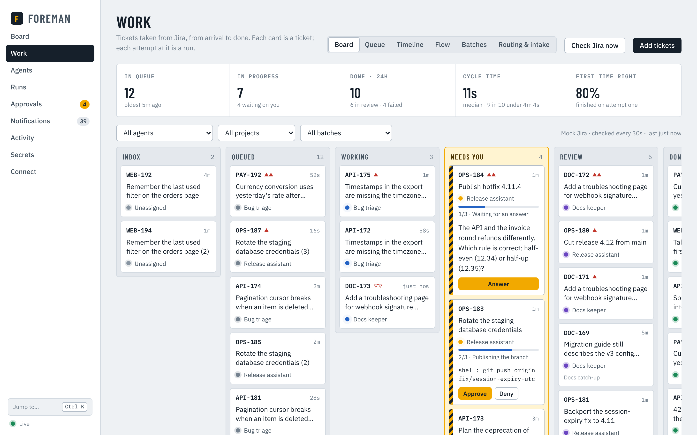
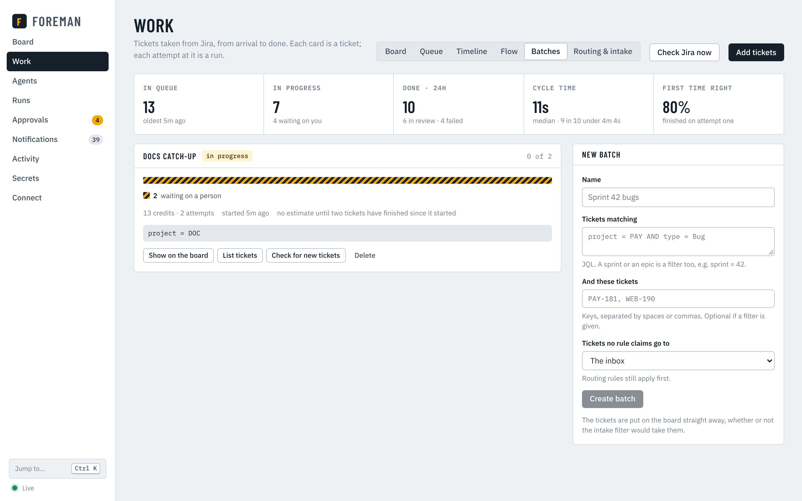
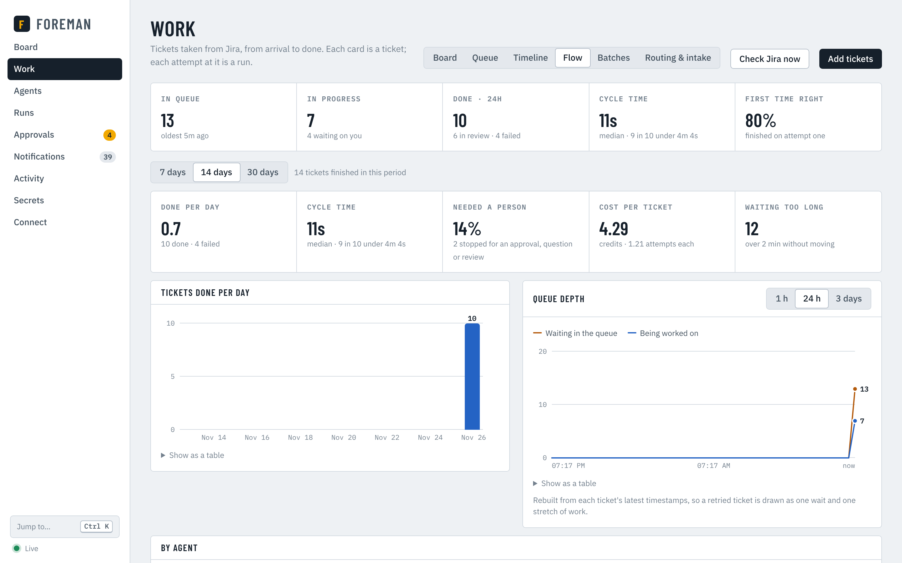
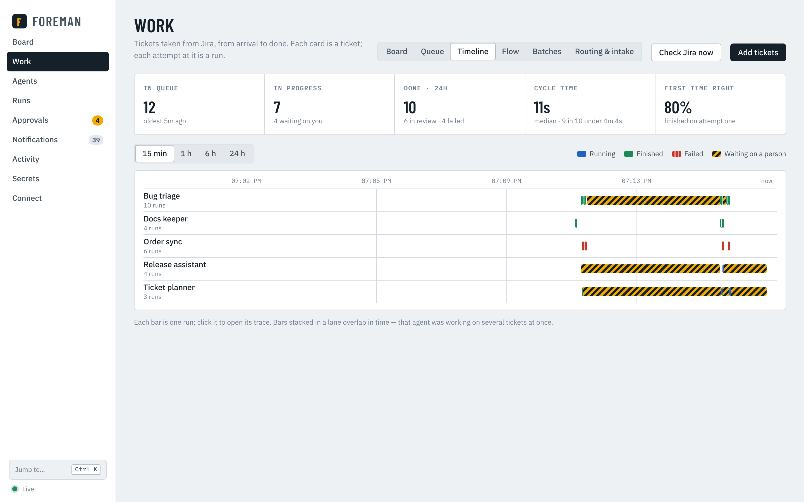
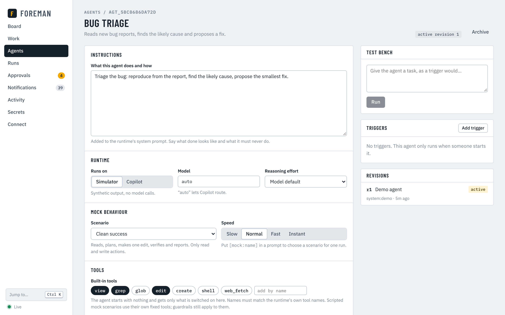
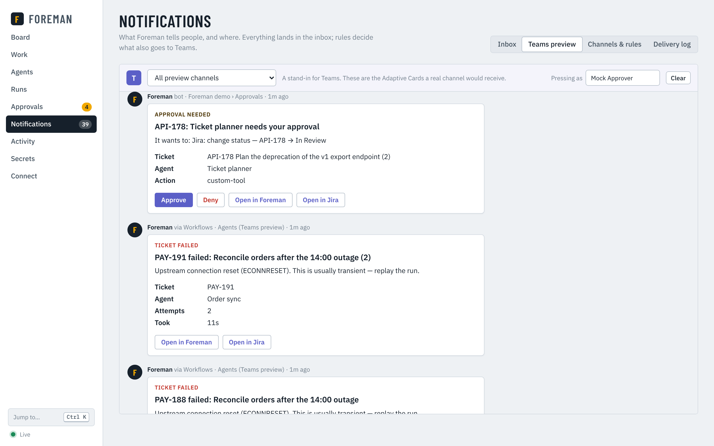
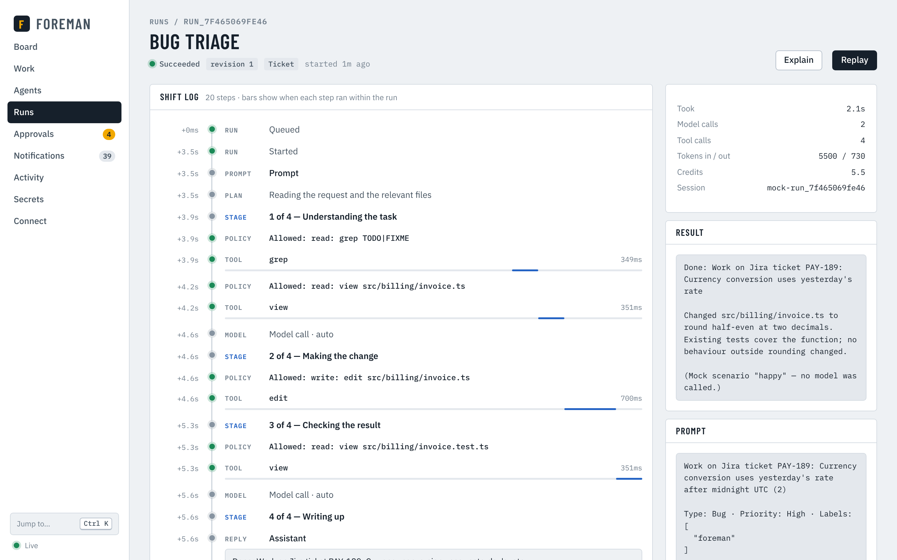

# Foreman

Orchestration for autonomous agents on the GitHub Copilot SDK. Configure agents, triggers and
guardrails in a web UI; every action is also an MCP tool.

Plans: [PLAN.md](PLAN.md) (overall), [PLAN-2-work-queue.md](PLAN-2-work-queue.md) (Jira, Teams, mock).



*The Board — what needs a person, what is running, and how the last day went. All screenshots in
this file are from `npm run demo`, so the tickets, agents and numbers are the demo's own.*

## Run it

Needs Node 22.13 or newer.

```bash
npm install
npm run build      # builds the web UI
npm run demo       # sample agents + a live feed of mock work, kept in memory
npm start          # normal mode, data saved in ./data
```

Open http://localhost:4517. The MCP endpoint is http://localhost:4517/mcp.

The **Connect** page shows the endpoint, ready-made client settings, and a console where every
capability can be called by hand:



For UI development run `npm run dev` (server with reload on 4517, Vite on 5173).

## Work queue

The **Work** page is a board of tickets taken from Jira: inbox → queued → working → needs you →
review → done, with failed off to the side. Routing rules decide which agent gets which ticket;
a ticket can be attempted several times, held, reordered, reassigned or skipped.

Until a real Jira site is configured, intake uses a **built-in mock Jira** (same REST shapes, seeded
with tickets, with a ticket generator). Give a mock ticket a label such as `mock:needs-approval`,
`mock:asks-question` or `mock:flaky` to choose how the mock agent behaves on it. Everything on the page is also an MCP
tool (`work_*`, `routing_*`, `jira_*`, `mockjira_*`).



## Batches, flow and the timeline

Three more views on the Work page:

- **Batches** — track a set of tickets as one job: a Jira filter (a sprint or an epic is a filter
  too), a list of keys, or both. Each batch shows done / working / waiting on a person / failed /
  queued, its cost, and a finish estimate from its own pace. One notification ("Batch finished")
  goes out when every ticket has finished. The board can be filtered to one batch.
- **Flow** — tickets done per day, cycle time, queue depth over time, load and results per agent
  with cost per ticket, the share of tickets that needed a person, and tickets waiting too long.
- **Timeline** — one lane per agent with each run as a bar, and the stretches spent waiting on a
  person marked. Shows load, idle gaps and overlaps.

Over MCP: `batches_*`, `work_flow`, `work_timeline`.







The demo had been running for only a few minutes when these were taken, so Flow has a single day
of data and the Timeline a few minutes of runs.

## Connecting a real Jira

Under **Work → Routing & intake → Jira connection**, enter the site address and how to sign in:

- **Jira Cloud** — the account's email and an [API token](https://id.atlassian.com/manage-profile/security/api-tokens).
- **Jira Data Center** — a personal access token.

The token is stored encrypted under **Secrets** and is never shown again. "Save and test" asks Jira
who the credentials belong to. Leave the site empty to go back to the built-in mock.

**Updates to tickets** is off until you turn it on. When on, Foreman itself comments on a ticket
when work starts, when an agent asks a question, and when it finishes or fails, and can move the
ticket to a status you name for each of those points.

## What agents can do in Jira, and asking a person

Foreman gives every agent two tools on any runtime: `report_progress` (drives the progress bar)
and `ask_for_info` (asks a person a question and waits; the ticket moves to *Needs you* until it
is answered on the board, the Approvals page or with `work.answer`).

Switch on the Jira tools per agent in the studio: `jira_get_issue`, `jira_search`,
`jira_add_comment`, `jira_transition`, `jira_create_subtask`. The ones that change a ticket go
through the agent's guardrails, so a rule `jira_transition → ask` keeps a person in the loop.



## Secrets

Credentials are encrypted at rest (AES-256-GCM), can be stored and used but never read back — in
the UI, the API or MCP — and are removed from run traces if a value ever appears in one. The key
is a file, `vault.key`, in the data directory (back it up with the database), or is derived from
`FOREMAN_SECRET_KEY` when that is set. MCP server settings may hold `{{secret:NAME}}` in a header
or environment value. Notification channel addresses are encrypted the same way.

## Notifications

Approvals, failed and finished tickets, tickets waiting too long, Jira outages and a daily digest
all land in the in-app **inbox**. Rules decide which of them also go to a **channel**:

- **Teams** — paste the address of a Teams *Workflows* webhook ("When a Teams webhook request is
  received"). Foreman posts Adaptive Cards with buttons that open Foreman and Jira.
- **Teams bot** — with an Azure Bot registration, approvals and questions arrive as cards with
  working **Approve**, **Deny** and answer buttons. A press is checked against Microsoft's signed
  token, decided as that Teams user (and audited so), and the card updates in place — also when
  the decision is made in Foreman instead. An optional list of approvers limits who may decide.
- **Teams preview** — a built-in stand-in that renders the same cards, so rules and card design can
  be tested without a tenant. With the bot in mock mode, its buttons work here too, through the
  same signed path as real Teams.
- **Webhook** — plain JSON to any URL.

Every delivery is logged with its result; failures are retried twice.



Jira can also call Foreman: give Jira the address under Work → Routing & intake → Instant pickup
as a webhook, and new tickets are picked up at once instead of at the next check.

## No Copilot subscription needed

New agents use the **mock runtime**: scripted scenarios (clean success, stops for approval, tool
failure, flaky, timeout, over budget, sub-agents, wrong result shape) that go through the real
guardrails, approvals, budgets and traces. Pick a scenario per agent in the studio, or put
`[mock:name]` in a prompt.

Every run, mock or not, leaves a trace — each policy decision, tool call and model call, with
timing — plus its cost, result and prompt, and can be replayed:



Or **bring your own key**: an agent on the `copilot` runtime can name its own model provider
(OpenAI-compatible, Azure OpenAI or Anthropic), endpoint and a stored API key, and then runs on the
real Copilot agent runtime with no Copilot subscription. Foreman's tools and guardrails work as
usual; the agent's own MCP servers do not load in this mode (the runtime allows them only with a
Copilot account). The built-in endpoint `/mock/model/v1` stands in for a provider, so this path
runs here without any key — the demo's "Model-backed reader" uses it. No real provider has been
tried yet, and runs on a Copilot subscription have not been tried at all.

## Working on the code

`AGENTS.md` is the guide for coding agents (and people) changing this repository. It links to a
guide for each part: core, capabilities, the run engine, the work queue, notifications, secrets,
the server, the web UI and the Copilot adapter.

## Layout

| Path | What |
|---|---|
| `packages/core` | Domain model, capability registry, run engine, policy, triggers, mock runtime, SQLite store |
| `packages/runtime-copilot` | Copilot SDK adapter |
| `apps/server` | HTTP API, live stream, webhooks, MCP server, demo mode |
| `apps/web` | React UI |
| `spike` | The first SDK spike and its findings |

## Settings

| Variable | Default | Meaning |
|---|---|---|
| `FOREMAN_PORT` / `FOREMAN_HOST` | `4517` / `127.0.0.1` | Where to listen. A non-loopback host requires a token |
| `FOREMAN_TOKEN` | unset | Bearer token for the API and MCP |
| `FOREMAN_DATA_DIR` | `./data` | Database and workspaces |
| `FOREMAN_SECRET_KEY` | unset | Passphrase for the secrets vault, instead of the `vault.key` file |
| `FOREMAN_GITHUB_TOKEN` | unset | Token for the Copilot runtime instead of the signed-in user |

## Test

```bash
npm test
npm run typecheck
```
